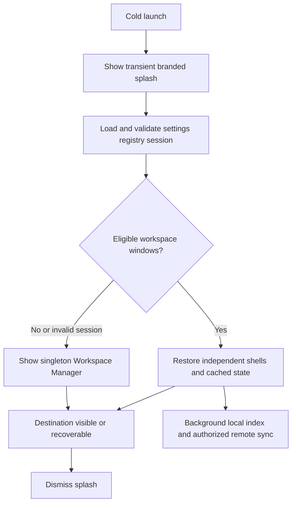
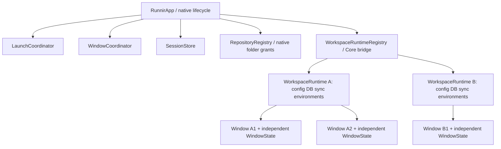

# Desktop Lifecycle And Workspace Windows

Status: target specification with a partial native implementation, updated 2026-10-15. DesktopCoordinator implements splash/Manager routing, independent windows, local registry/session and scoped imports. [Verification and limitations](desktop-foundation-verification.md) distinguish shipped code from the remaining acceptance scenarios. [ADR 0003](../decisions/0003-workspaces-sessions-offline-storage.md) reconciles this with ADR 0002.

## Terminology

Repository: one local Git working tree, optionally linked to GitHub. Workspace: its registered Runnir context, one per local working-tree instance in MVP. workspaceId: stable registry identity independent of URL/path. windowId: UUID of an individual window. Workspace Manager: singleton import/open/relink window. Splash: transient startup-only window. Runtime: shared workspace service object, not a promise of a subprocess. Cached snapshot: last observed data with explicit freshness. Manual close: user closes a window while app operates. Quit: app termination preserving remaining eligible windows.

No multi-repo workspace, automatic clone, cloud session/database sync, workflow auto-restart or restoration of live process/shell state in MVP.

## Startup Routing



Use a native borderless AppKit window hosting SwiftUI, centered on the active/primary display. Display branding promptly, optional truthful progress and reduced-motion behavior. Initialize asynchronously; never sleep just to extend branding. Show destination before/while dismissing splash. Invalid session/bootstrap failure routes to recoverable manager/error; no endless splash. Quit during bootstrap cancels/cleans up initialization. Splash/Settings/Manager/modals are excluded from the workspace restore set.

| Launch/activation case | Destination |
| --- | --- |
| First launch, invalid session, or all windows manually closed | Manager; invalid data gets a non-blocking warning |
| Quit with one/many workspace windows | Restore each eligible window in deterministic order |
| Missing/inaccessible repo | Recoverable shell with Locate/Grant Access/Remove choice, or explicitly reported skipped window |
| Running with zero windows, Dock activation | Show/focus exactly one manager |
| Running with windows, repeated activation | Normal native focus; no duplicate restoration |

Dashboard remains the default tab inside a newly opened workspace, not the unconditional app startup route. GitHub login is optional for local opening. Remote synchronization never gates shell/cached UI visibility.

## Workspace Manager

Recent registered local repositories ordered by lastOpenedAt, display name, device-local path and availability/open-window indicators. Actions: open, focus existing, intentionally open another window, import existing local repo, locate/relink moved repo and remove registration with clear local-data effects. Create Repository is hidden until separately implemented. Removal never deletes the working tree or .runnir files implicitly.

Resolve/register -> prepare destination -> show cached/local UI -> close Manager only once destination is ready. On failure keep Manager and source windows usable. Closing Manager does not quit the app. Cmd+N / File > Open Workspace opens/focuses Manager; final key bindings must respect native menus. Paths are private local UI data excluded from analytics/reports.

## Window Actions

| Action | Identity and persistence | Shared work |
| --- | --- | --- |
| Manual Cmd+W/red close | Commit removal of that windowId before declaring close complete; honor unsaved edits/active-execution policy | Detach only this window's subscribers; other windows/runtime unaffected |
| Cmd+Q/menu Quit | Set terminationInProgress, resolve unsaved/active work, snapshot currently eligible windows, flush, then teardown; cancelled quit returns to normal mode | Stop/clean up app-owned execution; no background daemon implied |
| Reuse Current Window | Retain windowId; prepare destination then commit reassociation to new workspaceId; rollback on failure | Source remains usable until transition committed |
| Open New Window | Allocate new windowId; preserve source window/session entry completely | Reuse target runtime if already present |
| Focus Existing Window | Focus chosen target; no new identity or entry | No duplicate sync/runtime |
| Close final workspace window | Stay running without forcing a manager | Suspend/dispose only idle services according to explicit policy |

Same repository in two windows means independent selection/tab/navigation/scroll/geometry, shared domain cache/index/sync. Window geometry is advisory and clamped for missing monitors/scales. Never serialize ephemeral dialogs, credentials or process IDs as resumable state.

## SessionStore Contract

Resolve Application Support with native APIs. The first implementation combines registry and session in versioned desktop-state.json for atomic association changes (ADR 0003). The separate session.json shape below is a conceptual target, not the implemented wire format:

```json
{
  "version": 1,
  "windows": [{
    "id": "5CE88FF0-5C16-43B3-8F20-8E33E852B019",
    "workspaceId": "ws-a7d1",
    "selectedTab": "workflows",
    "selectedWorkflow": "deploy.yml",
    "frame": {"x": 120, "y": 100, "width": 1280, "height": 800},
    "displayId": null
  }]
}
```

Single actor/queue serializes mutations; schema migration/validation checks types, duplicate IDs, missing associations, bounded frames and known navigation identifiers. Critical opened/closed/reassociated entries commit immediately; debounce geometry/navigation only. Do not use a single debounce for close events. Define last-known-good recovery and close tombstone ordering so restoring an older backup cannot resurrect durably closed windows. Corrupt JSON never crashes launch; do not overwrite recovery evidence silently.

Use one authoritative workspace-restoration mechanism. Coordinate SwiftUI scenes/AppKit callbacks explicitly; validate actual API availability against the project's macOS 15 deployment target during implementation. Quit-triggered willClose notifications must not erase the snapshot. Repeated restore/Dock calls are idempotent. Persisted UI eligibility is separate from actual process liveness.

## Ownership



Swift owns native lifecycle/UI/Keychain; portable services remain Go-owned behind transport-independent boundaries. Do not create a Go process, database writer or GitHub sync loop per window. Session events and runtime events require future versioned IPC contracts, not arbitrary command execution.

## Acceptance And Tests

| ID | Scenario / required evidence |
| --- | --- |
| L01 | First launch: splash -> Manager -> import repo without .runnir -> workspace; no silent file writes |
| L02 | Quit with A+B: both restore with correct IDs/selections, cached content before network |
| L03 | Manually close A, quit with B: only B restores; close all then restart: Manager |
| L04 | Dock twice with zero windows: one Manager; Manager close leaves app running |
| L05 | Reuse A's window for B: same windowId; failed destination keeps A usable |
| L06 | New B window preserves A; same A twice has independent UI and one shared runtime/sync |
| L07 | Offline launch/missing repo/relink/invalid session: useful recovery, unrelated windows still open |
| L08 | Crash immediately after committed manual close: window never resurrects; crash during navigation write preserves valid session |
| L09 | Missing monitor, minimize/fullscreen and quit-cancellation/unsaved changes respect native behavior |
| L10 | Active execution on quit is stopped/cleaned up; next launch marks interrupted/unknown history and never restarts it |

Unit tests cover session/registry identities, serialized mutations and rollback. Integration tests must exercise actual AppKit callback ordering, durability/crash injection, Dock activation and multi-window independence; a mocked store alone cannot substantiate the guarantees.
